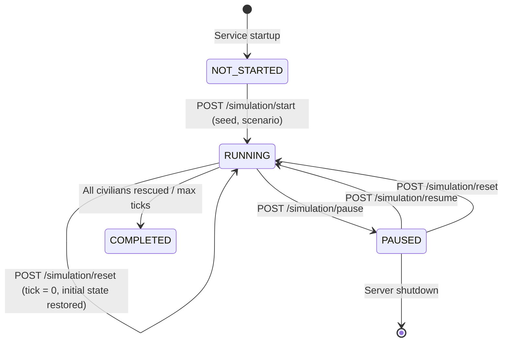

# RESQ-AI Architecture Specification

## 1. System Overview

**RESQ-AI** is an AI-powered Disaster Response and Rescue Simulator designed to model urban disaster scenarios (such as floods and earthquakes) and coordinate multi-agent emergency response operations.

The system is developed through an incremental 8-phase lifecycle:
- **Phase 1: Project Foundation & Architecture**: Decoupled client-server setup, baseline data contracts, API definitions, testing pipeline, and initial state orchestration.
- **Phase 2: Disaster Environment & Simulation Engine (Current)**: Deterministic 2D synthetic city environment, procedural road and building networks, numerical flood propagation, structural earthquake collapse, aftershocks, affected civilians, evacuation shelters, and complete simulation lifecycle controls.
- **Phase 3: Civilian Incident Generation & Urgency Modeling**: Detailed physiological degradation, civilian clustering, distress beacons, and emergency triage.
- **Phase 4: Rescue Agents & Capability Matrix**: Drones, boats, ambulances, and heavy rescue units with speed, capacity, and terrain constraints.
- **Phase 5: Pathfinding & Route Navigation**: A*, Dijkstra, and dynamic rerouting around flooded/collapsed road segments.
- **Phase 6: Multi-Agent Rescue Coordination & AI Dispatch**: Centralized dispatch heuristic / decentralized auction mechanism for optimal task assignment.
- **Phase 7: Shelters, Depots & Resource Logistics**: Medical supplies, fuel limitations, triage shelters, and resource replenishment loops.
- **Phase 8: Comprehensive Telemetry, Replay & Evaluation**: Real-time visualization, analytics, simulation replay, and performance metrics (survival rate, response time).

---

## 2. High-Level Architecture Diagram

```mermaid
graph TD
    subgraph Frontend ["Next.js (App Router, TypeScript, Tailwind)"]
        UI["Operations Dashboard UI"]
        Controls["Disaster Engine Controls (components/SimulationControls.tsx)"]
        ApiClient["REST API Client (lib/api.ts)"]
    end

    subgraph Backend ["FastAPI Backend (Python 3.12)"]
        Router["FastAPI Application & Routers"]
        SimService["Simulation Service (services/simulation_service.py)"]
        
        subgraph EnginePackage ["services/simulation/"]
            Engine["SimulationEngine (engine.py)"]
            GridGen["CityGridGenerator (grid_generator.py)"]
            FloodMod["FloodSimulationModel (flood_model.py)"]
            EqMod["EarthquakeSimulationModel (earthquake_model.py)"]
            Scenarios["Scenarios Catalog (scenarios.py)"]
        end

        DataContracts["Data Contracts & Validation (schemas/environment.py & simulation.py)"]
    end

    UI --> Controls
    Controls --> ApiClient
    ApiClient -->|HTTP REST (JSON)| Router
    Router --> SimService
    SimService --> Engine
    Engine --> GridGen
    Engine --> FloodMod
    Engine --> EqMod
    Engine --> Scenarios
    Engine --> DataContracts
```

---

## 3. Environment & Grid Architecture

### 3.1 Cell Matrix & Topography
The city environment is represented as a 2D matrix of `GridCell` objects indexed by row and column `(r, c)`:
- **`TerrainType`**: Fixed physical classification:
  - `ROAD`: Interconnected street network for vehicular transit.
  - `BUILDING`: Structural urban block. Blocks flood water penetration; impassable for rescue units.
  - `OPEN_GROUND`: Parks, parking plazas, and staging zones.
  - `SHELTER`: High-elevation reinforced emergency facility.
- **`HazardState`**: Dynamic hazard status:
  - `SAFE`: Dry, clear, and fully accessible.
  - `FLOODED`: Water depth between 0.25m and 1.50m. Passable with caution.
  - `DEBRIS_BLOCKED`: Structural rubble with severity >= 2.0. Completely impassable.
  - `DANGEROUS`: Deep water (>= 1.50m). Impassable for standard ground vehicles.
- **`Traversability`**: Determined dynamically:
  $$\text{Traversable} = (\text{terrain} \neq \text{BUILDING}) \land (\text{hazard} \neq \text{DEBRIS\_BLOCKED}) \land (\text{water\_level} < 1.50)$$

---

## 4. Disaster Mechanics Engine

### 4.1 Flood Propagation Model
- **Inflow Sources**: Designated boundary or ruptured infrastructure points inject water volume at each tick ($+0.60\text{m}$ up to a maximum cap of $5.0\text{m}$).
- **Diffusion & Hydraulic Head**: Water flows to orthogonal neighbors based on hydraulic head differential:
  $$\text{Head}_{\text{cell}} = \text{Elevation}_{\text{cell}} + \text{WaterLevel}_{\text{cell}}$$
- **Building Resistance**: Buildings act as impermeable walls; water diffuses exclusively through roads and open ground.
- **Bounded Invariants**: Water levels strictly satisfy $0.0 \le \text{water\_level} \le 5.0$.

### 4.2 Earthquake Damage & Aftershock Model
- **Epicenter & Rubble Deposition**: On initialization, seismic energy radiating from an epicenter damages buildings, scattering rubble onto adjacent road segments.
- **Structural Integrity**: Shelters are seismically reinforced and remain protected.
- **Discrete Aftershocks**: Geological tremors occur at scheduled ticks (e.g. tick 3 and tick 7), triggering secondary localized debris without behaving like a continuous liquid flow.

---

## 5. Simulation Lifecycle State Machine



- **Idempotent Inspection**: `GET /api/v1/simulation/state` reads the current snapshot without advancing time or mutating cell states.
- **Tick Guard**: Calling `POST /api/v1/simulation/tick` while `PAUSED` or `NOT_STARTED` is rejected with `HTTP 400 Bad Request`.
- **Deterministic Reset**: `POST /api/v1/simulation/reset` deep-copies the initial snapshot taken at tick 0, restoring the identical initial environment.
