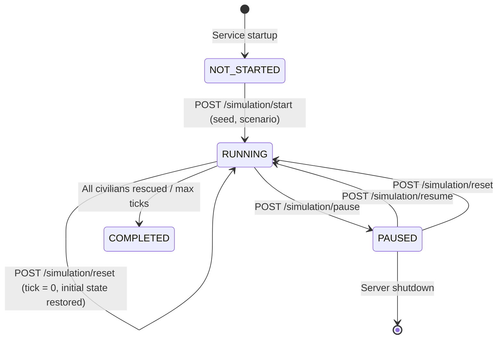

# RESQ-AI Architecture Specification

## 1. System Overview

**RESQ-AI** is an AI-powered Disaster Response and Rescue Simulator designed to model urban disaster scenarios (such as floods and earthquakes) and coordinate multi-agent emergency response operations.

The system is developed through an incremental 8-phase lifecycle:
- **Phase 1: Project Foundation & Architecture**: Decoupled client-server setup, baseline data contracts, API definitions, testing pipeline, and initial state orchestration.
- **Phase 2: Disaster Environment & Simulation Engine**: Deterministic 2D synthetic city environment, procedural road and building networks, numerical flood propagation, structural earthquake collapse, aftershocks, affected civilians, evacuation shelters, and complete simulation lifecycle controls.
- **Phase 3: Pathfinding & Route Navigation**: A* pathfinding with hazard-aware movement profiles (`ground_responder` vs `on_foot`) and dynamic obstacle avoidance.
- **Phase 4: Intelligent Rescue Prioritization & Civilian Triage**: Multi-factor deterministic triage scoring, dynamic physiological deterioration, hazard exposure tracking, and priority queue ordering.
- **Phase 5: Multi-Agent Rescue Coordination & Autonomous Dispatch (Current)**: Heterogeneous rescue agents, mission lifecycle, autonomous dispatch to top triage targets, path navigation via A*, civilian pickup, transport, dynamic replanning, and shelter evacuation.
- **Phase 6: Decentralized Task Allocation & Auction Mechanisms**: Distributed market-based negotiation and multi-agent coordination.
- **Phase 7: Shelters, Depots & Resource Logistics**: Medical supplies, fuel limitations, triage shelters, and resource replenishment loops.
- **Phase 8: Comprehensive Telemetry, Replay & Evaluation**: Real-time visualization, analytics, simulation replay, and performance metrics (survival rate, response time).

---

## 2. High-Level Architecture Diagram

```mermaid
graph TD
    subgraph Frontend ["Next.js (App Router, TypeScript, Tailwind)"]
        UI["Operations Dashboard UI"]
        Controls["Disaster Engine Controls (components/SimulationControls.tsx)"]
        FleetUI["Rescue Fleet Panel (components/RescueAgentPanel.tsx)"]
        MissionUI["Mission Dispatch Console (components/MissionControlPanel.tsx)"]
        GridUI["2D City Grid View (components/CityGridView.tsx)"]
        ApiClient["REST API Client (lib/api.ts)"]
    end

    subgraph Backend ["FastAPI Backend (Python 3.12)"]
        Router["FastAPI Application & Routers"]
        SimService["Simulation Service (services/simulation_service.py)"]
        
        subgraph EnginePackage ["services/simulation/"]
            Engine["SimulationEngine (engine.py)"]
            Coordinator["RescueCoordinator (dispatcher.py)"]
            Prioritizer["RescuePrioritizer (prioritization.py)"]
            Pathfinder["AStarPathfinder (pathfinding.py)"]
            CivModel["CivilianDeteriorationModel (civilian_model.py)"]
            GridGen["CityGridGenerator (grid_generator.py)"]
            FloodMod["FloodSimulationModel (flood_model.py)"]
            EqMod["EarthquakeSimulationModel (earthquake_model.py)"]
            Scenarios["Scenarios Catalog (scenarios.py)"]
        end

        DataContracts["Data Contracts & Validation (schemas/agent.py, environment.py & simulation.py)"]
    end

    UI --> Controls
    UI --> FleetUI
    UI --> MissionUI
    UI --> GridUI
    Controls --> ApiClient
    ApiClient -->|HTTP REST (JSON)| Router
    Router --> SimService
    SimService --> Engine
    Engine --> Coordinator
    Coordinator --> Prioritizer
    Coordinator --> Pathfinder
    Engine --> CivModel
    Engine --> FloodMod
    Engine --> EqMod
    Engine --> DataContracts
```

---

## 3. Environment & Grid Architecture

### 3.1 Cell Matrix & Topography
The city environment is represented as a 2D matrix of `GridCell` objects indexed by row and column `(r, c)`:
- **`TerrainType`**: Fixed physical classification:
  - `ROAD`: Interconnected street network for vehicular transit.
  - `BUILDING`: Structural urban block. Blocks flood water penetration; impassable for rescue units.
  - `OPEN_GROUND`: Parks, parking plazas, and staging zones.
  - `SHELTER`: High-elevation reinforced emergency facility.
- **`HazardState`**: Dynamic hazard status:
  - `SAFE`: Dry, clear, and fully accessible.
  - `FLOODED`: Water depth between 0.25m and 1.50m. Passable with caution.
  - `DEBRIS_BLOCKED`: Structural rubble with severity >= 2.0. Completely impassable.
  - `DANGEROUS`: Deep water (>= 1.50m). Impassable for standard ground vehicles.

---

## 4. Disaster Mechanics Engine

### 4.1 Flood Propagation Model
- Inflow Sources inject water volume at each tick ($+0.60\text{m}$ up to a maximum cap of $5.0\text{m}$).
- Water diffuses through roads and open ground according to hydraulic head differential:
  $$\text{Head}_{\text{cell}} = \text{Elevation}_{\text{cell}} + \text{WaterLevel}_{\text{cell}}$$
- Buildings act as impermeable barriers.

### 4.2 Earthquake Damage & Aftershock Model
- Seismic tremors damage buildings and scatter structural debris onto adjacent roads.
- Discrete aftershocks trigger secondary localized debris without behaving like continuous fluid flow.

---

## 5. Simulation Lifecycle State Machine



---

## 6. Phase 4: Intelligent Rescue Prioritization & Civilian Triage

### 6.1 Multi-Factor Triage Scoring Formula
$$\text{Score} = S_{\text{urgency}} + S_{\text{health}} + S_{\text{trapped}} + S_{\text{hazard}} + S_{\text{injured}} + S_{\text{waiting}}$$

1. **Urgency Contribution ($S_{\text{urgency}}$)**: `CRITICAL` ($+40.0$), `HIGH` ($+25.0$), `MEDIUM` ($+15.0$), `LOW` ($+5.0$).
2. **Health Deficit Contribution ($S_{\text{health}}$)**: $(100 - \text{health}) \times 0.30$ (up to $+30.0$).
3. **Trapped Physical Status ($S_{\text{trapped}}$)**: $+15.0$ if physically trapped.
4. **Environmental Hazard Exposure ($S_{\text{hazard}}$)**: $+15.0$ for dangerous water ($\ge 1.5$m); up to $+12.0$ for structural debris; up to $+10.0$ for flooded roadways.
5. **Injury Status ($S_{\text{injured}}$)**: $+8.0$ if injured.
6. **Elapsed Waiting Time ($S_{\text{waiting}}$)**: $+1.0$ per tick awaiting rescue, **capped at $+10.0$**.

---

## 7. Phase 5: Multi-Agent Rescue Coordination & Autonomous Dispatch

### 7.1 Heterogeneous Rescue Agent Model
Rescue agents are situated entities navigating the 2D synthetic city environment:
- **`GROUND_RESPONDER`**: Heavy emergency ambulance operating primarily on roadways and clear ground. Uses `MovementProfile.GROUND_RESPONDER`. Traverses safe roads at unit cost ($1.0$), avoids deep flooding ($\ge 1.5$m) and heavy debris ($\ge 2.0$).
- **`FOOT_RESPONDER`**: Specialized search and rescue foot team operating on all passable surfaces. Uses `MovementProfile.ON_FOOT`. Can wade through shallow floodwaters ($< 1.0$m) with traversal penalties, reaching isolated residents cut off from vehicular access.

### 7.2 Mission Lifecycle State Machine

```mermaid
stateDiagram-v2
    [*] --> ASSIGNED: Triage dispatch assigns idle agent
    ASSIGNED --> EN_ROUTE: Agent begins A* path navigation
    EN_ROUTE --> RESCUING: Agent reaches civilian coordinate
    RESCUING --> TRANSPORTING: Civilian boarded (IN_TRANSIT); route to shelter calculated
    TRANSPORTING --> COMPLETED: Agent reaches shelter coordinate; civilian safely sheltered
    EN_ROUTE --> FAILED: Target coordinate completely impassable
    TRANSPORTING --> FAILED: All evacuation shelters blocked or at capacity
    ASSIGNED --> CANCELLED: Mission invalidated or target missing
    COMPLETED --> [*]: Agent returns to IDLE state
    FAILED --> [*]: Agent released to IDLE or UNAVAILABLE
```



### 7.3 Deterministic Dispatch Policy (`RescueCoordinator`)
1. **Candidate Triage Queue**: Obtain ranked unrescued civilians from `RescuePrioritizer.rank_civilians(...)`.
2. **Eligibility Filtering**: Consider only civilians with status $\neq \text{RESCUED}$ and $\neq \text{IN\_TRANSIT}$ that are not currently assigned to any active mission.
3. **Responder Pool**: Filter agents that are `IDLE` with `current_mission_id is None`.
4. **Feasibility Evaluation**: For each candidate civilian along the triage queue:
   - For each available agent, plan an A* route from `agent.coordinate` to `civilian.coordinate` with the agent's exact movement profile.
   - If feasible routes exist, select the winning agent using stable tie-breaking:
     $$\min(\text{route\_cost}) \implies \min(\text{path\_length}) \implies \text{agent\_id asc}$$
   - Create and record `RescueMission`, update agent to `EN_ROUTE`, set `active_path`.
   - If no available agent can reach the civilian, the dispatcher logs the impediment and defers to the next triage candidate without blocking lower-priority reachable victims.

### 7.4 Autonomous Movement & Collision Avoidance
- **Speed**: Default 1 grid step per tick.
- **Deterministic Right-of-Way**: When two agents intend to move into the exact same non-shelter grid cell on the same tick, the agent with lower lexicographical ID proceeds. The other agent yields, staying stationary for 1 tick with an event log entry.
- **Shelter Depot Capacity**: Depots/shelters can house multiple stationary or arriving agents simultaneously.

### 7.5 Civilian Extraction & Shelter Evacuation
- **Extraction**: When an `EN_ROUTE` agent reaches the civilian's coordinate, civilian status is set to `IN_TRANSIT` aboard the agent. While in transit, civilians are protected from ground hazard environmental decay and do not accumulate waiting ticks.
- **Destination Selection**: `find_nearest_available_shelter` finds the closest reachable shelter with available capacity (`current_occupancy < capacity`) using A*.
- **Evacuation**: When the agent arrives at the shelter:
  - Civilian status becomes `RESCUED`.
  - Shelter `current_occupancy += 1`.
  - Engine `rescued_count += 1`.
  - Agent `completed_rescues += 1`.
  - Agent status returns to `IDLE`.

### 7.6 Dynamic Replanning Pipeline
At each tick before movement:
- If an agent's next planned step is blocked by rising flood waters or structural earthquake debris, the agent triggers an immediate A* replan to the target/shelter.
- If an alternate path exists, the route and `active_path` are updated, and the agent continues.
- If no path exists, the mission fails cleanly and the agent is released.

### 7.7 Execution Order per Simulation Tick
To eliminate race conditions, double movement, and inconsistent states, each simulation step (`SimulationEngine.step()`) executes strictly in the following deterministic sequence:
1. **Disaster Advancement**: Flood propagation models and earthquake debris models step.
2. **Civilian Deterioration**: `CivilianDeteriorationModel.step_civilians` updates unrescued, non-in-transit civilians.
3. **Active Agent Movement & Evacuation**: Active responders check route passability, trigger dynamic replanning if blocked, execute single-step moves with collision yielding, and process arrivals (extraction or shelter delivery).
4. **Autonomous Dispatch**: `RescueCoordinator.dispatch_idle_agents` assigns newly available or idle agents to top triage targets.
5. **State Synchronization**: Telemetry and event logs are compiled into `TickResult`.
